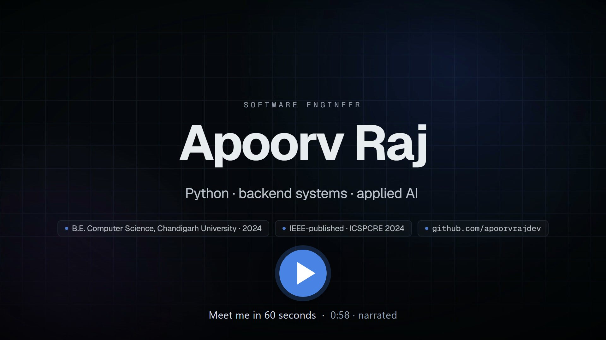

 

---

## About Me

I'm Apoorv — a Python software engineer who builds backend services, REST APIs and data-driven applications, and who likes taking machine-learning models the rest of the way: validated inputs, reliable data handling, automated tests and repeatable deployments.

- **Now:** AI Engineer (independent contractor, founding contributor) at **[Node2.io](https://www.node2.io)** — Python/FastAPI AI services for a PropTech SaaS, including an LLM booking assistant built with LangChain tool calling, a complaint-prioritisation engine, and resident/staff features in a Next.js + TypeScript app on PostgreSQL (Supabase)
- **Backend & data:** FastAPI, Pydantic validation, SQLAlchemy, schema design, constraints and Alembic migrations on PostgreSQL and SQLite
- **Applied ML:** XGBoost and TensorFlow models served behind tested APIs, with evaluation and explainability (SHAP) treated as part of the product
- **Research:** IEEE-published — *AI Narratives: Bridging Visual Content and Linguistic Expression* (CNN + Transformer image captioning), ICSPCRE 2024
- Open to software engineering and applied-AI roles, and to collaborating on research-driven projects

B.E. Computer Science & Engineering, Chandigarh University (2024) &nbsp;·&nbsp; Python for Data Science, AI & Development — IBM &nbsp;·&nbsp; AWS Cloud Technical Essentials — AWS

---

## Meet Me in 60 Seconds

https://github.com/user-attachments/assets/ed85cead-67ed-4e3d-bc2c-a31d65dfed1f

  
</a>

▶ Click to play (MP4, 1920×1080, 58 s, narrated, 7.7 MB) &nbsp;·&nbsp; <a href="video/narration-script.md">Read the script</a> &nbsp;·&nbsp; <a href="video/README.md">How it was made</a>

---

## Selected Projects

### Fraud Radar — real-time card-fraud scoring with explanations

[Repository](https://github.com/apoorvrajdev/fraud-radar) · [Live demo](https://fraud-radar-lilac.vercel.app) · [24-second demo video](https://github.com/apoorvrajdev/fraud-radar#-product-demo)

A FastAPI service that scores card transactions by combining **6 deterministic business rules with an XGBoost model**, attaches a **SHAP attribution to every decision**, and lands flagged transactions in an analyst review queue with an append-only audit log. React + TypeScript dashboard for KPIs, flagged transactions and analyst decisions.

- Data layer on SQLAlchemy (SQLite in development, Postgres-compatible schemas) with exact decimal amounts, database constraints, versioned migrations and retry-safe ingestion via idempotency keys — a retried request is never stored twice
- Service-layer scoring latency p50 **3.7 ms**; **1,407 unit and integration tests**, `ruff` and `mypy --strict` in CI
- Evaluation reported honestly: PR-AUC **0.93** on a held-out fold of the project's own synthetic generator, and a separate PR-AUC **0.77** on 284,807 real anonymised transactions (ULB) on an isolated track. These measure how learnable the datasets are, not production fraud-detection effectiveness

### Image Captioning System — IEEE-published research, shipped as a tested app

[Repository](https://github.com/apoorvrajdev/image-captioning-system) · [Live app](https://image-captioning-system.vercel.app) · [27-second demo video](https://github.com/apoorvrajdev/image-captioning-system#-product-demo) · [Paper](https://doi.org/10.1109/ICSPCRE62303.2024.10675203)

The InceptionV3 + Transformer captioning model from my IEEE paper, rebuilt from a research notebook into an installable, typed Python package, a Dockerized FastAPI service on Hugging Face Spaces and a React app on Vercel. Greedy or beam-search decoding, with input validation and clear error responses at the API boundary.

- Retrained in TensorFlow on a 120,000-caption COCO 2017 sample with an image-level train/validation split, after finding and fixing a validation bug inherited from the original research code
- **563 pytest tests** (Python 3.10 and 3.11) and **27 Playwright end-to-end tests** run on every change; deployment passes only after the model loads and returns a real caption
- Evaluated with BLEU, METEOR, ROUGE-L and CIDEr; a pre-registered, blinded audit showed most of an apparent BLEU-4 gap against the paper came from the number of reference captions, not the model

---

## Tech Stack

**Languages**

**Backend & APIs**

**Databases**

**Data & ML**

**Testing & Delivery**

---

## Experience & Education

- **Node2.io** — AI Engineer (Independent Contractor, Founding Contributor) · Jan 2026 – present · PropTech SaaS, remote with a Canada-based team
- **Freelance Software Developer** — independent client projects · 2024 – Dec 2025
- **Quicksilver Technologies Pvt. Ltd.** — ML Engineering Intern · May – Jul 2023 · Python data-processing scripts, debugging tools and unit tests for validation workflows
- **Chandigarh University** — B.E. Computer Science and Engineering, CGPA 7.66/10 · 2024
- **Publication** — [AI Narratives: Bridging Visual Content and Linguistic Expression](https://doi.org/10.1109/ICSPCRE62303.2024.10675203), IEEE ICSPCRE 2024

---

## GitHub Stats

---

*"The model is the easy part — I build the tested software around it."*

